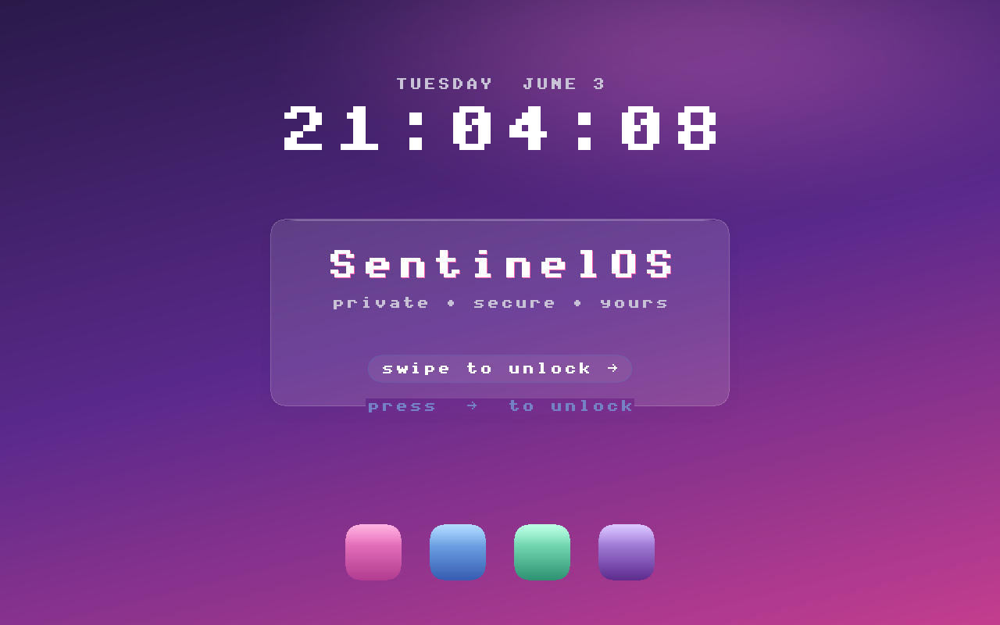
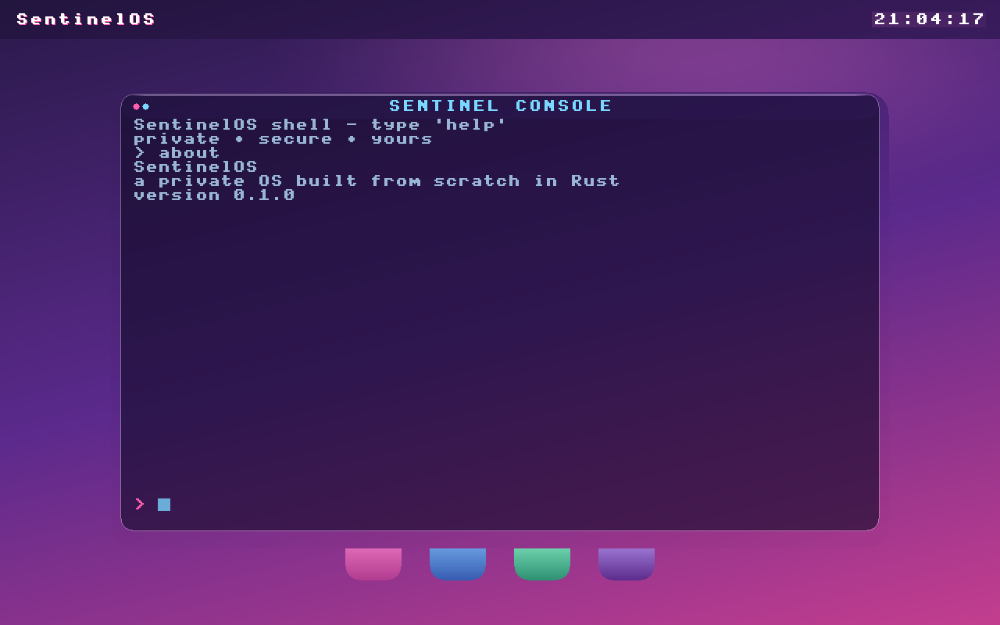

# SentinelOS

A from-scratch x86-64 operating system kernel in Rust, built so that all `unsafe` code sits in one small crate.

The bet is security as architecture, not an add-on. The `kernel` and `ui` crates are `#![forbid(unsafe_code)]`, so a memory-safety bug there is a compile error. Every `unsafe` operation lives in `hal` and `boot`, each with a `// SAFETY:` argument and an evidence row in [`kernel/docs/hal-tcb.md`](kernel/docs/hal-tcb.md) (1,224 lines). The kernel builds on stable Rust.

Status: pre-alpha. It boots in QEMU to a desktop with a shell. 240 commits, 2026-06-03 to 2026-11-06, about 60,000 lines of Rust in the kernel workspace (tests included). No real-hardware boot is recorded in this repo.

 

## Works today

- Boot: Limine, GDT/IDT/TSS, PIC and PIT, then IOAPIC routing read from the ACPI MADT. Frame allocator, paging, kernel heap.
- Desktop: PS/2 keyboard and mouse, a framebuffer GUI ("Cyber Dusk" lock screen, window manager with Terminal, Files, Net and System Panel), a 15-command shell.
- Multi-core: every application processor online, a per-CPU scheduler, IPI wake-ups, 100 Hz LAPIC timer preemption on each core.
- Network: e1000 driver with ARP, IPv4 and ICMP. It pings the QEMU gateway at boot. No TCP or UDP.
- AI compute: int8 GEMM in scalar, AVX2, AVX-512F and VNNI tiers, self-tested on every core at boot. AMX is detected, not implemented.
- Components: content-addressed (SHA-256) components on a kernel bus. The kernel stamps the sender. Capabilities are deny by default, and Kani proves they never amplify. Components run as native kernel code, with no process isolation yet.
- SentinelFS storage layer: copy-on-write tree, SHA-256 on every pointer, two superblock slots. Tested with a crash-point property test (2,744 crash points) and a QEMU run where a commit is cut mid-write and the previous one mounts intact.
- CPU security: NX, SMEP, SMAP and UMIP enforced.

## Not yet

- Login. The lock screen checks nothing, the right arrow unlocks. The spec is in `docs/specs/2026-10-04-identity-login-design.md`.
- SentinelFS under the shell. The shell still uses a toy filesystem: one image rewritten whole to the IDE disk, so a crash mid-write loses it. Files on the new tree (FS-2) come next.
- User mode. Whether untrusted code runs as wasm or in ring 3 is an open decision, written up in `docs/os/STATE.md`.
- Component delegates, the AMX tier, TCP/UDP, a richer desktop.
- GPU acceleration and app or game compatibility. [`VISION.md`](VISION.md) says why those are long-horizon.
- Sentinel Security Center (Tauri app, `sentinel-core`, `provider-macos`): 4 of the 20 designed vectors work, macOS only. The kernel does not use `sentinel-core` yet.

## Build and run

Needs the stable Rust toolchain. `rust-toolchain.toml` adds the target and components.

```
rustup target add x86_64-unknown-none
cd kernel
cargo build --target x86_64-unknown-none
cargo test -p kernel --lib --target x86_64-unknown-linux-gnu   # host unit tests, use your host triple
```

To boot it you also need `make`, `qemu-system-x86_64`, `xorriso` and the pinned Limine release:

```
git clone --branch v11.4.1-binary --depth 1 https://github.com/limine-bootloader/limine.git limine
make -C limine
make run          # build the ISO and launch QEMU
make test         # headless boot, asserts the serial log, ends with TEST PASSED
make screenshot   # framebuffer PNG over QMP
```

CI runs fmt, clippy with `-D warnings`, the build, host tests, `make test`, a KVM SMP job, Miri (nightly) and Kani on every PR. `main` was green at `1f3c477` on 2026-11-06. Today there are 436 kernel and 47 hal unit tests, and 84 Kani harnesses in the tree (not all gate CI).

## Layout

- `kernel/crates/hal`: the `unsafe` core. `boot`: entry point and Limine handoff.
- `kernel/crates/kernel`: scheduler, drivers, net stack, SentinelFS, components, shell. `ui`: rendering.
- `kernel/xtask`: host-side build and boot-test driver. Boot proofs are hard assertions there.
- `docs/specs`: design docs. `docs/os/STATE.md`: where things stand.
- `sentinel-core`, `provider-macos`, `src-tauri`, `ui`: the Sentinel Security Center. It came first (2026-06-03), and its core crate is meant to port into the OS later.

## What I learned

- Every CI job needs a time cap. Two `cargo kani` runs sat for 5 h 38 min and 5 h 41 min against GitHub's 6 h default before anyone saw they would never finish. Now each job has a timeout and a workflow checks it.
- Proofs have a budget. Several Kani harnesses were split to fit solver time and memory (a 333 s MADT harness, a 400 s leaf-packing one). Review rounds also cut proof claims down to what each harness covers.
- Waiting on hardware hides bugs. A poll-count ATA timeout flaked CI under host load, so waits now use a TSC deadline plus a channel reset. The first VirtualBox boot hung with 2+ vCPUs because spinning APs never exited to the hypervisor and the PIT never fired. QEMU never showed it. APs are parked early now.
- The `unsafe` core is the part that needs a person. Any change under `hal` waits for my sign-off. Four `ata.rs` items from the latest review are still waiting for it.
- A boot test should assert, not print. `make test` cuts QEMU mid-commit (SIGKILL, `cache=writeback`) and fails unless the recovery boot mounts the previous commit exactly.

## Built with coding agents

183 of the 184 non-merge commits carry a Claude co-author trailer, and Claude wrote almost all of the code. I set the direction (VISION.md, the decisions in STATE.md), merged the PRs, and sign off `hal`. Agent roles for design, review and verification are in `.claude/agents`.

## License

None yet. All rights reserved until one is added.
